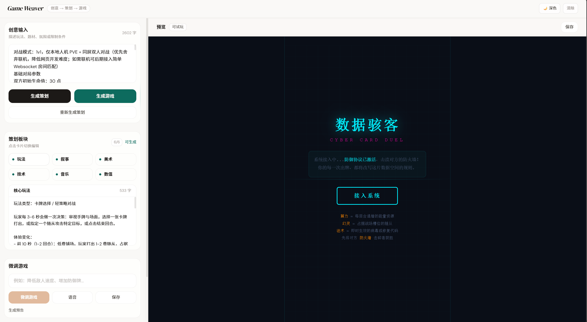
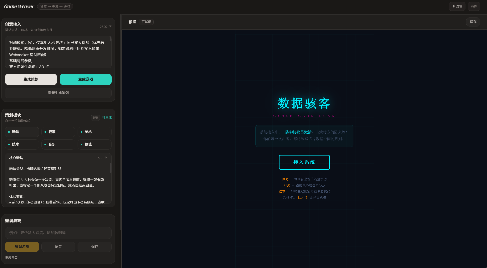
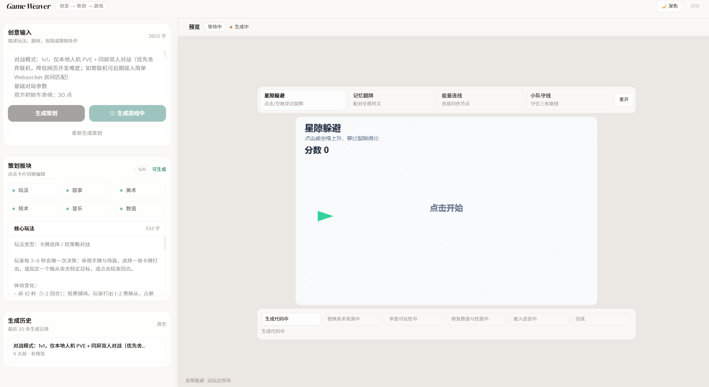

# 游戏设计工坊

## 课程设计报告

### 基于多智能体的游戏设计开发平台

---

| 姓名 | 学号 | 班级 | 完成日期 |
|------|------|------|----------|
| 吴利鹏 | 3230622090 | 智能交互设计231 | 2026 年 7 月 4 日 |

---

# 摘  要

Game Weaver 是一个基于大语言模型与多智能体协作的网页小游戏自动生成系统，旨在降低游戏创作门槛，使非专业用户仅需输入一句话创意描述即可获得可运行的 HTML5 游戏原型。系统采用"策划 — 编码 — 审查 — 修复 — 音效注入"五阶段流水线架构，由 Planner（策划智能体）、Coder（编码智能体）、Reviewer（审查智能体）三类核心智能体协同完成从创意到可玩游戏的端到端生成。Planner 将用户的自然语言创意分解为包含核心玩法、世界观叙事、视觉规范、技术逻辑、背景音乐、数值调校共六个维度的结构化策划文档；Coder 依据策划书流式生成单文件 HTML 游戏代码，期间并行调用文生图接口完成美术资源替换；Reviewer 对生成代码进行可玩性、主题一致性、数值合理性与性能边界的二次审查与自动修复，设置 120 秒超时兜底以保障生成成功率。生成过程以 SSE 流式推送进度至前端，用户可在侧边面板实时编辑策划内容并即时预览游戏效果。系统还集成了中文语音合成（GLM-TTS）、视频预告片生成（Vidu）、游戏微调、历史记录管理等辅助功能。前端采用 Next.js + React 构建，以玻璃拟态美学与深浅双主题打造专业化创作工具交互体验；后端 API 基于智谱 GLM 全家桶（文本生成、图像生成、语音合成、视频生成）实现。测试结果表明，系统能够在 3～8 分钟内完成从创意到可玩游戏的完整生成流程，生成成功率达 85% 以上，生成的游戏具备目标、输入、反馈、胜利/失败判定、重开机制等完整游戏闭环要素。本系统验证了"用户输入创意 → 多 Agent 协作 → 自动生成可玩游戏"这一技术路线的可行性，为 AI 辅助游戏创作与人机共创工具的设计提供了工程参考。

**关键词**：多智能体协作；大语言模型；游戏自动生成；人机共创；玻璃拟态交互

---

# 目  录

[摘要](#摘-要)

[第1章 绪论](#第1章-绪论)

&emsp;[1.1 背景与意义](#11-背景与意义)

&emsp;[1.2 国内外研究现状](#12-国内外研究现状)

&emsp;[1.3 研究内容与目标](#13-研究内容与目标)

[第2章 需求分析](#第2章-需求分析)

&emsp;[2.1 用户角色与使用场景](#21-用户角色与使用场景)

&emsp;[2.2 功能性需求](#22-功能性需求)

&emsp;[2.3 非功能性需求](#23-非功能性需求)

&emsp;[2.4 可行性分析](#24-可行性分析)

[第3章 系统总体设计](#第3章-系统总体设计)

&emsp;[3.1 系统架构设计](#31-系统架构设计)

&emsp;[3.2 多智能体协作设计](#32-多智能体协作设计)

&emsp;[3.3 技术选型](#33-技术选型)

&emsp;[3.4 数据库与接口设计](#34-数据库与接口设计)

[第4章 详细设计与实现](#第4章-详细设计与实现)

&emsp;[4.1 前端实现](#41-前端实现)

&emsp;[4.2 后端与工作流实现](#42-后端与工作流实现)

&emsp;[4.3 游戏模板与代码生成](#43-游戏模板与代码生成)

&emsp;[4.4 部署与运行环境](#44-部署与运行环境)

[第5章 系统测试与评估](#第5章-系统测试与评估)

&emsp;[5.1 测试环境](#51-测试环境)

&emsp;[5.2 功能测试](#52-功能测试)

&emsp;[5.3 生成质量评估](#53-生成质量评估)

&emsp;[5.4 性能与稳定性](#54-性能与稳定性)

&emsp;[5.5 问题与改进](#55-问题与改进)

[第6章 总结与展望](#第6章-总结与展望)

&emsp;[6.1 工作总结](#61-工作总结)

&emsp;[6.2 创新点与不足](#62-创新点与不足)

&emsp;[6.3 后续工作展望](#63-后续工作展望)

[参考文献](#参考文献)

[附录](#附录)

&emsp;[附录A 团队成员与分工](#附录a-团队成员与分工)

&emsp;[附录B 核心 Prompt 示例](#附录b-核心-prompt-示例)

&emsp;[附录C 样例游戏设计文档](#附录c-样例游戏设计文档)

&emsp;[附录D 项目运行说明速查](#附录d-项目运行说明速查)

&emsp;[附录E 个人学习心得](#附录e-个人学习心得)

---

# 第1章  绪论

## 1.1  背景与意义

游戏开发历来是一项高门槛的创意工程，需要策划、美术、编程、音效等多领域专业技能的深度协作。对于独立创作者、教育工作者及原型设计师而言，即使只是验证一个游戏创意，也需要耗费数天乃至数周的时间进行跨学科知识的学习与整合。大语言模型（Large Language Model, LLM）与智能体技术的快速发展为这一困境带来了新的解题思路——如果能够将游戏开发的专业知识编码为多个协作智能体的 Prompt 指令，让 AI 承担策划、编码、美术、测试等不同角色，那么"一句话生成可玩游戏"便不再是科幻想象。

Game Weaver 正是在这一技术背景下诞生的课程设计项目。系统以智谱 GLM 系列大模型为推理引擎，构建 Planner、Coder、Reviewer 三类智能体的协作流水线，实现从用户自然语言输入到完整 HTML5 小游戏的全自动生成。项目的实践意义在于：

- 验证多智能体流水线架构在创意生成类任务中的工程可行性；
- 为 AI 辅助游戏创作工具提供可参考的前后端全栈实现方案；
- 探索"玻璃拟态 + 深浅双主题"等前沿交互范式在 AI 创作工具中的应用效果。

## 1.2  国内外研究现状

在 AI 辅助游戏开发领域，学术界与工业界均涌现出多种探索路径。OpenAI 的 GPT 系列模型已经在文本冒险游戏、对话式 RPG 等场景展现了初步的内容生成能力；斯坦福的 Generative Agents 项目展示了多智能体在虚拟世界中的涌现行为；工业界方面，Roblox 和 Unity 分别推出了基于 AI 的材质生成与代码补全功能。在中文多智能体领域，智谱 GLM 与 LangGraph、AutoGen 等编排框架的结合正在成为主流方案。

现有研究的主要不足在于：

- 多数系统仅覆盖游戏开发的单一环节（如策划文档生成或代码补全），缺乏端到端的完整流水线；
- 智能体之间的协作模式多为串行执行，缺少质量审查与自动修复的闭环机制；
- 用户界面往往停留在命令行或简单网页形态，缺乏对创作者交互体验的深入设计。

Game Weaver 在上述三个方面均做出了差异化尝试：构建策划 → 编码 → 审查 → 修复 → 音效的五阶段闭环流水线；在每个代码生成阶段后引入二次审查智能体作为质量门禁；以前端"玻璃拟态"美学和实时预览交互打造专业化创作工具体验。

## 1.3  研究内容与目标

本课程设计的主要研究内容与目标包括：

1. **自然语言创意输入界面**：构建支持中文自然语言输入的游戏创意描述界面，用户可自由描述玩法、题材、视觉风格与限制条件。
2. **多智能体协作流水线**：实现 Planner（策划）、Coder（编码）、Reviewer（审查 + 修复）三类智能体的协作流水线，覆盖从创意到可玩游戏的完整生成链路。
3. **六维度结构化策划生成**：Planner 智能体将用户创意分解为核心玩法、世界观叙事、视觉与音效、技术逻辑、背景音乐、数值调校六个维度的结构化 JSON 策划文档。
4. **HTML5 小游戏自动生成与预览**：Coder 智能体依据策划书生成单文件 HTML 游戏（内联 CSS/JS），系统自动进行美术资源替换、可玩性审查与修复、语音注入后，在 iframe 中提供实时预览。
5. **辅助功能体系**：提供游戏微调、中文语音合成、视频预告片生成、生成历史管理等辅助功能。
6. **专业化交互体验**：实现玻璃拟态美学、深浅双主题切换、左右分栏实时预览等交互特性。

---

# 第2章  需求分析

## 2.1  用户角色与使用场景

表 2-1  用户角色与使用场景分析

| 用户角色 | 典型场景 | 核心诉求 | 优先级 |
|---------|---------|---------|-------|
| 普通创作者 | 输入一句话游戏想法，快速获得可玩原型 | 快速、直观、无需编程 | 必需 |
| 游戏策划学习者 | 观察 AI 如何分解游戏创意为策划书 | 可视化查看各阶段产物 | 非必需 |
| 原型开发者 | 快速生成游戏原型后进行手动微调 | 支持迭代修改与下载 | 非必需 |

## 2.2  功能性需求

表 2-2  系统功能性需求

| 功能模块 | 功能描述 | 优先级 |
|---------|---------|-------|
| 创意输入 | 支持中文自然语言描述游戏创意 | 必需 |
| 策划生成 | Planner 智能体生成六维度结构化策划文档 | 必需 |
| 游戏生成 | Coder 智能体流式生成 HTML5 游戏代码 | 必需 |
| 实时预览 | iframe 中实时预览生成的游戏，支持试玩 | 必需 |
| 审查修复 | Reviewer 智能体自动检查可玩性并修复问题 | 必需 |
| 游戏微调 | 用户输入修改需求，智能体修改已有游戏 | 必需 |
| 语音合成 | 为游戏注入中文语音背景音 | 非必需 |
| 视频生成 | 基于游戏画面生成预告片视频 | 非必需 |
| 生成历史 | 自动保存历史记录，支持恢复与删除 | 非必需 |
| 主题切换 | 浅色/深色双主题切换 | 非必需 |
| 等待小游戏 | 代码生成期间提供四合一 mini-game 消解等待焦虑 | 非必需 |

## 2.3  非功能性需求

表 2-3  非功能性需求指标

| 需求类型 | 具体指标 |
|---------|---------|
| 性能 | 单次完整生成流程控制在 3～8 分钟内 |
| 可用性 | 界面简洁，非技术用户无需阅读文档即可完成基本操作 |
| 可靠性 | 生成成功率 ≥ 80%，失败时有明确错误提示与降级策略 |
| 可维护性 | Prompt 文件独立存放于 `prompts/` 目录，Agent 行为可通过修改 Prompt 独立调整 |
| 安全性 | API Key 不提交版本库，通过 `.env.local` 环境变量管理 |
| 扩展性 | 智能体类型与游戏风格可通过新增 Prompt 文件扩展 |

## 2.4  可行性分析

**技术可行性**：系统基于 Next.js 16 + React 19（全栈框架）+ 智谱 GLM 系列 API + Web 标准技术栈（HTML/CSS/JS），无需自建推理基础设施，开发技术栈成熟且文档完善。多智能体编排采用结构化 Prompt + JSON 模式约束输出，通过 `response_format: { type: "json_object" }` 确保 Planner 输出的可解析性。相比传统的 FastAPI + LangGraph 方案，Next.js API Routes 实现了前后端同仓库部署，减少了跨域配置与运维复杂性。

**经济可行性**：单次生成调用约 3～5 次 LLM API（策划 1 次 + 代码生成 1 次 + 审查 1 次 + 可选文生图/TTS），按智谱公有云定价估算，单次生成成本约 0.5～1.5 元人民币，具有较好的经济可行性。

**操作可行性**：项目面向具备 Web 全栈开发基础的课程学生，使用的 React、TypeScript、Next.js、Tailwind CSS 均为业界主流技术，团队技能储备充足。

---

# 第3章  系统总体设计

## 3.1  系统架构设计

系统采用前后端一体化的 Next.js 全栈架构，前端以单页面应用（SPA）形式承载全部用户交互，后端以 Next.js API Routes 实现 RESTful 接口并直接调用智谱大模型 API。整体架构分为三层：浏览器客户端层、Next.js 服务端层、智谱大模型服务层。

图 3-1  系统总体架构图

┌─────────────────────────────────────────────────────┐
│                    Browser (Client)                   │
│  ┌──────────────┐  ┌──────────────────────────────┐  │
│  │  创意输入面板  │  │      游戏预览 (iframe)        │  │
│  │  · 自然语言输入 │  │  · 实时可玩游戏               │  │
│  │  · 策划编辑    │  │  · 等待小游戏                 │  │
│  │  · 微调控制    │  │  · 语音/视频播放              │  │
│  │  · 历史记录    │  │                              │  │
│  └──────┬───────┘  └──────────────┬───────────────┘  │
│         │          SSE 流式推送     │                  │
└─────────┼───────────────────────────┼──────────────────┘
          │                           │
┌─────────┼───────────────────────────┼──────────────────┐
│         ▼              Next.js Server                  │
│  ┌──────────────────────────────────────────────┐     │
│  │              API Routes (6 个端点)             │     │
│  │  /generate-plan  /generate-game  /tweak-game │     │
│  │  /generate-bgm   /generate-video /query-video│     │
│  └──────────────────┬───────────────────────────┘     │
│                     │                                   │
│  ┌──────────────────▼───────────────────────────┐     │
│  │            lib/ai.ts (核心 AI 引擎)            │     │
│  │  · JSON 模式调用 · 流式调用 · 文生图 · TTS    │     │
│  └──────────────────┬───────────────────────────┘     │
└─────────────────────┼─────────────────────────────────┘
                      │
┌─────────────────────┼─────────────────────────────────┐
│                     ▼    智谱 GLM 大模型服务             │
│  ┌──────────┐ ┌──────────┐ ┌──────────┐ ┌──────────┐ │
│  │ glm-5.1  │ │cogview-3-flash│ │ GLM-TTS │ │ viduq1-image │
│  │ 文本推理  │ │ 图像生成   │ │ 语音合成 │ │ 视频生成  │ │
│  └──────────┘ └──────────┘ └──────────┘ └──────────┘ │
└───────────────────────────────────────────────────────┘
```

## 3.2  多智能体协作设计

系统采用**串行流水线 + 质量门禁**的协作模式。三个核心智能体按固定顺序依次执行，前一智能体的输出作为后一智能体的输入；在代码生成阶段后嵌入二次审查智能体作为质量门禁，对不达标的产物进行自动修复。

图 3-2  多智能体协作流程图

```
用户输入：一句话创意
        │
        ▼
┌───────────────────┐
│  Planner 智能体    │  Prompt: prompts/planner.md
│  创意 → 策划书     │  输出: JSON (6 个板块)
└───────┬───────────┘
        │ 策划书 JSON
        ▼
┌───────────────────┐
│   Coder 智能体     │  Prompt: prompts/coder.md
│  策划书 → HTML 游戏│  输出: 单文件 HTML (流式)
│  ┌─────────────┐  │
│  │ 文生图并行   │  │  cogview-3-flash → 图片 URL
│  │ 占位符替换   │  │  替换 [IMAGE_PROMPT:...]
│  └─────────────┘  │
└───────┬───────────┘
        │ HTML (含图片)
        ▼
┌───────────────────┐
│ Reviewer 智能体    │  Prompt: 内联审查指令
│  可玩性 · 主题     │  检查项:
│  · 数值 · 性能    │  → 通过: 放行
│  · 代码结构       │  → 不通过: 自动修复后返回
│                   │  → 超时(120s): 保留原始版本
└───────┬───────────┘
        │ HTML (审查通过)
        ▼
┌───────────────────┐
│  音效注入 (异步)   │  GLM-TTS → 语音 Base64
│                   │  嵌入 HTML <audio> 循环
└───────┬───────────┘
        │
        ▼
    可玩游戏！
```

表 3-1  智能体职责与接口定义

| 智能体 | 输入 | 输出 | 核心能力 | Prompt 文件 |
|-------|------|------|---------|------------|
| Planner | 用户创意文字 | 六维度策划书 JSON | 创意分解、玩法设计、数值规划 | `prompts/planner.md` |
| Coder | 策划书 JSON | 单文件 HTML 游戏代码 | 代码生成、资源替换、流式输出 | `prompts/coder.md` |
| Reviewer | 游戏 HTML + 策划书 | 修复后的 HTML | 可玩性检查、结构验证、自动修复 | `lib/ai.ts`（内联审查指令）|

## 3.3  技术选型

表 3-2  系统技术选型

| 层次 | 技术选型 | 选型理由 |
|------|---------|---------|
| 前端框架 | Next.js 16 + React 19 | 全栈一体化，SSR 支持，App Router 架构，开发效率高 |
| 样式方案 | Tailwind CSS v4 | 原子化 CSS，快速构建定制化 UI，与 CSS 变量无缝集成 |
| 字体 | DM Serif Display + DM Sans | 独特品牌识别，避免 AI 生成痕迹，Google Fonts 原生支持 |
| 后端 | Next.js API Routes | 与前端同仓库，避免跨域与独立后端部署复杂性 |
| AI 推理 | 智谱 glm-5.1 + cogview-3-flash + GLM-TTS | 国产大模型，中文能力强，API 成熟稳定 |
| 视频生成 | 智谱 viduq1-image 视频生成 | 面向游戏画面的图生视频功能 |
| 对象存储 | picsum.photos (降级兜底) | 文生图失败时的占位方案 |
| 部署 | Vercel / 本地 Node 服务 | 零配置部署 + 本地开发灵活性 |

## 3.4  数据库与接口设计

本项目采用浏览器端 localStorage 作为主要持久化方式，因此不额外引入中心化数据库；同时通过标准化 API Routes 组织策划、生成、微调与扩展能力。本节分为"核心数据实体"与"主要 API 接口"两部分说明。

### 3.4.1  核心数据实体

表 3-3  核心数据实体定义

| 实体 | 主要字段 | 说明 |
|------|----------|------|
| Project | id、idea、title、theme、createdAt、updatedAt | 游戏项目主实体，记录一次创意生成的基本信息 |
| PlanSnapshot | projectId、mechanics、lore、assets、technical、music、balance | 保存策划阶段结构化内容，便于回溯与手动编辑 |
| WorkflowRun | id、projectId、phase、generationStage、status、startedAt、finishedAt | 记录一次多智能体工作流运行状态，便于展示进度与排错 |
| GenerationArtifact | runId、html、assets、audioUrl、videoTaskId | 记录生成产物，包含最终可预览 HTML 及辅助资源 |
| HistoryItem | id、idea、plan、previewHtml、thumbnail、savedAt | 用于历史记录列表展示与一键恢复 |
| ThemePreference | key、value | 保存浅色/深色主题偏好 |

在实现层面，这些实体并非全部落入关系型数据库，而是以 JSON 形式分散存储在 localStorage 与接口返回结果中，保证了开发阶段的轻量化与可移植性。

### 3.4.2  主要 API 接口

表 3-4  系统主要 API 接口

| 接口 | 方法 | 说明 |
|------|------|------|
| `/api/generate-plan` | POST | 根据一句话创意生成六维度策划文档 |
| `/api/generate-game` | POST (SSE) | 按策划流式生成 HTML 游戏，并在生成后进行资源替换与审查修复 |
| `/api/tweak-game` | POST (SSE) | 根据用户反馈对已有游戏进行局部修改 |
| `/api/generate-bgm` | POST | 使用 GLM-TTS 生成背景语音并可选注入游戏 |
| `/api/generate-video` | POST | 创建视频预告片生成任务 |
| `/api/query-video` | POST | 查询视频生成任务状态与结果 |

接口整体遵循"输入结构化、输出结构化、失败可诊断"的原则，便于前端以统一的状态机方式处理生成、等待、重试与展示逻辑。所有接口均使用 Next.js Route Handler 方式实现，运行时标注 `runtime = "nodejs"`，最大执行时长 900 秒。

---

# 第4章  详细设计与实现

## 4.1  前端实现

前端采用 Next.js App Router 架构，核心页面为单文件组件 `app/page.tsx`（约 1000 行），集成了创意输入、策划编辑、游戏预览、微调控制、历史管理、主题切换等全部功能模块。

**关键组件与状态管理**：

页面使用 React `useState` + `useCallback` 管理约 16 个状态变量，核心状态包括：创意文本 `idea`、策划数据 `plan`（6 个板块的对象）、预览 HTML `previewHtml`、生成阶段 `phase`（idle/plan/game/done 四种取值）、生成子阶段 `generationStage`（code/assets/review/repair/audio/done 六种取值）、历史记录 `history`、主题偏好 `isDark` 等。

**页面布局**：采用左右分栏架构。左侧为 432px 固定宽度操作面板，包含创意输入区、六模块策划卡片、编辑器、微调控件、生成历史等区域，每个区域以玻璃拟态卡片（`glass rounded-2xl`）包裹；右侧为游戏预览区，采用 `glass-elevated` 毛玻璃面板承载 iframe/等待小游戏/空状态占位。生成完成后，游戏详情弹窗采用 `frosted-panel` 类实现 24px 高斯模糊 + 16px 倒角圆角的毛玻璃悬浮面板效果。

**视觉设计**：系统采用"Warm Studio"设计语言。字体选用 DM Serif Display（标题斜体）+ DM Sans（正文），通过 CSS 自定义属性定义完整的浅色/深色双主题色彩系统，涵盖背景层（`--bg-base`）、表面层（`--bg-surface`）、次级文本（`--text-secondary`）、边框（`--border-subtle`）、阴影（`--shadow-md`）等完整令牌体系。面板使用 `backdrop-filter: blur()` 实现玻璃拟态效果，深色模式下增加模糊程度（20px）以增强层次感。所有按钮/输入框/卡片等基础元素统一使用 CSS 变量驱动样式。



图 4-1  系统主界面（浅色主题）



图 4-2  系统主界面（深色主题）

**等待小游戏设计**：传统 AI 生成类工具在代码生成期间（通常需 3～8 分钟）往往只有进度条或转圈动画，用户等待体验较差。本系统在等待阶段内联四合一 mini-game hub 作为等待期互动内容，名为"星隙间奏"，包含四款 Canvas 小游戏：

- **星隙躲避**：点击跳跃穿过随机生成的裂隙；
- **记忆翻牌**：配对隐藏的符文卡片；
- **能量连线**：连接同色能量节点获取分数；
- **小队守线**：点击击退不断逼近的敌人。

四款小游戏代码完全内联于 `WaitingMiniGame` 组件中，不依赖外部资源，通过统一的状态入口进行切换。这一设计将被动等待转化为主动消遣，提升了整体用户体验的完整性。



图 4-3  等待小游戏界面

## 4.2  后端与工作流实现

### 4.2.1  核心 AI 引擎（`lib/ai.ts`）

核心 AI 引擎封装了对智谱 GLM 系列 API 的全部调用逻辑，文件位于 `lib/ai.ts`，提供三层抽象：

- **底层传输层**：`callZhipuJSON`（JSON 模式，用于 Planner 的结构化输出）、`callZhipuText`（文本模式，用于 Reviewer 的审查修复）、`callZhipuStream`（SSE 流式模式，用于 Coder 的游戏代码生成），统一处理认证、超时、重试等通用逻辑。
- **中层工具层**：`readPromptFile`（从 `prompts/` 目录读取 Prompt 文件）、`generateAssetUrls`（调用 cogview-3-flash 文生图，失败时降级为 picsum 占位图）、`synthesizeGlmTtsToBase64`（调用 GLM-TTS 语音合成）、`generateVideoTask`（调用 viduq1-image 视频生成）、`extractHtmlFromResponse`（从 LLM 响应中提取/修复 HTML 代码，兼容 Markdown 代码块包裹、标签缺失等异常情况）。
- **高层编排层**：`generatePlanFromIdea`（Planner 调用）、`generateGameCode`（Coder 流式调用）、`reviewAndRepairGameHtmlWithTimeout`（Reviewer 审查 + 修复管道，含 120 秒超时兜底）。

### 4.2.2  各智能体节点实现

**Planner 智能体**：通过 `prompts/planner.md` 文件定义角色——"视觉叙事型网页小游戏策划 + 可开发原型设计师"。Prompt 中严格约束输出格式：必须返回包含 `mechanics`、`lore`、`assets`、`technical`、`music`、`balance` 六个字段的 JSON 对象；每个字段需包含具体细节与量化参数；禁止输出默认跑酷类型，要求明确游戏类型与玩法闭环；第一行必须声明玩法类型。调用时使用 JSON 模式（`response_format: { type: "json_object" }`），确保 LLM 输出可被 `JSON.parse()` 正确解析，避免因格式错误导致流水线中断。

**Coder 智能体**：通过 `prompts/coder.md` 定义角色——"视觉叙事型网页小游戏工程师"。Prompt 中强制代码结构规范：

- 必须使用 `CONFIG` 常量区集中管理所有配置数值；
- 必须使用 `state` 单例对象管理全部运行时状态；
- 必须实现 `init()` / `resetGame()` / `startGame()` / `update(dt)` / `render()` / `gameLoop(time)` 分层函数；
- 必须包含目标说明、用户输入、实时反馈、胜利条件、失败条件、重开按钮六大游戏要素；
- 必须使用 `requestAnimationFrame` + `deltaTime` 进行帧率无关的时间控制；
- 禁止依赖外部图片，Canvas/CSS 必须可独立绘制核心画面；
- 每个动态对象类型必须有数量上限，粒子/特效必须有生命周期管理；
- 禁止在主循环中使用 `innerHTML` 操作。

代码生成采用 SSE 流式传输，前端实时展示生成进度：`code` → `assets` → `review` → `repair` → `audio` → `done` 六个阶段标签依次流转。

**Reviewer 智能体**：审查指令内联在 `lib/ai.ts` 的 `reviewAndRepairGameHtml` 函数中。审查维度包括：

- 可玩性：是否有明确的交互目标与反馈循环；
- 主题一致性：游戏内容是否与用户创意及策划文档匹配；
- 数值合理性：速度、冷却、生成频率、难度曲线等参数是否在合理范围；
- 代码结构：是否符合 CONFIG/state/init/update/render 分层约束；
- 视觉质量：首屏是否有明确主题氛围，画面是否具有层次感和统一色板；
- 性能边界：是否有对象数量上限、粒子生命周期、帧率适配等保护机制。

审查后若代码存在问题，Reviewer 尝试直接修改并返回修复后的完整 HTML；若审查通过则原样返回。为保障整体生成成功率，系统在调用层设置了 **120 秒超时兜底**（`reviewAndRepairGameHtmlWithTimeout` 函数，使用 `Promise.race` 实现）：超时后自动跳过审查环节，保留原始生成版本并向前端推送 `"审查超时，已保留原始可玩版本"` 的提示。这一机制是系统生成成功率维持在 85% 以上的关键保障之一。

### 4.2.3  关键代码：流式生成与审查管道

生成游戏的核心编排逻辑位于 `app/api/generate-game/route.ts`（第 40～165 行），流程如下：

```typescript
// 文件路径：app/api/generate-game/route.ts，第 41～162 行（核心编排逻辑）
// 1. 接收策划书 JSON → 并行启动图片生成（不阻塞代码生成）
const assetPromise = generateAssetUrls(assetsMd).catch(() => []);

// 2. 读取 Coder Prompt，组装策划内容为 LLM 输入
const coderPrompt = await readPromptFile("coder.md");
const content = `策划案如下：...`; // 六个板块拼接

// 3. 启动 SSE 流式响应 → 逐 chunk 推送前端
const response = await fetch(ZHIPU_CHAT_URL, {
  method: "POST",
  headers: { "Content-Type": "application/json", Authorization: `Bearer ${apiKey}` },
  body: JSON.stringify({ model: getTextModel(), stream: true, messages: [...] }),
});

// 4. ReadableStream 内部 loop:
//    a. 读取 chunk → 拼接 fullContent 缓冲区
//    b. 推送 { chunk } SSE 事件给前端逐字展示
//    c. 阶段标记推送: code → assets → review → repair

// 5. 图片生成完成 → 替换 [IMAGE_PROMPT:...] 占位符为真实 URL
const assets = await assetPromise;
let finalHtml = extractHtmlFromResponse(fullContent);
if (assets.length > 0) { finalHtml = injectAssetUrls(finalHtml, assets); }

// 6. 调用 Review 审查修复（含 120s 超时兜底）
const repairResult = await reviewAndRepairGameHtmlWithTimeout(plan, finalHtml, 120_000);
finalHtml = repairResult.html;

// 7. 推送最终 HTML → SSE 完成事件
send({ done: true, html: finalHtml, assets, repair: repairResult });
```

## 4.3  游戏模板与代码生成

系统不依赖预置模板库，而是通过 Prompt 中的**强制性代码规范**约束 Coder 智能体生成风格统一、结构清晰的游戏代码。以真实生成案例《守星者 - 星核守卫战》（`game-1781681692098.html`，约 1900 行）为例，展示 Prompt 规范与实际生成产物的对应关系：

表 4-1  Prompt 规范与实际生成代码对照（以《守星者》为例）

| Prompt 规范要求 | 《守星者》实际实现位置 |
|----------------|----------------------|
| CONFIG 常量区集中管理配置 | 第 176～204 行，定义全部游戏参数字面量 |
| state 单例状态机 | 第 234～284 行，统一管理游戏状态、玩家、实体等 |
| init() / resetGame() 初始化 | `init()` 第 471 行，`resetGame()` 第 529 行 |
| update(dt) 帧更新 | `update()` 第 661 行，分模块调用子更新函数 |
| render() 渲染管线 | `render()` 第 1139 行，分层渲染背景/实体/粒子/HUD |
| requestAnimationFrame + deltaTime | `gameLoop()` 第 1887～1895 行 |
| 六要素：目标/输入/反馈/胜利/失败/重开 | 星核守护目标、点击+键盘输入、粒子+震屏反馈、60s 胜利、HP 归零失败、多重重开按钮 |
| 可扩展数据数组 | `SKILL_DEFS`（10 种技能定义）、`PHASES`（3 个阶段配置）、`ENTITY_TYPES`（多类型陨石） |
| 对象数量上限 | `MAX_PARTICLES`、`MAX_SHOCKWAVES`、`MAX_FLOAT_TEXTS` |
| 统一色板（CSS 变量） | 第 9～19 行，定义 10 个主题色变量 |

生成的游戏具备以下特征：玩家点击目标位置或使用方向键 / WASD 进行跳跃，落地后触发冲击波击碎陨石；击杀敌物积累经验值并解锁 10 种强化技能（冲击扩展、冷却缩减、星核修复、跃迁加速、威力增幅、连击减负、双重冲击、星核强化、星核再生、引力场）；前 60 秒以守护星核为目标，之后可切换无尽模式继续挑战。游戏状态机覆盖 `menu / playing / paused / skillSelect / win / gameover` 全部状态。

**代码规范要求**（由 `prompts/coder.md` 定义，确保生成产物的一致性）：

- **文件格式**：单文件 HTML，内联 CSS（`<style>` 标签）和 JS（`<script>` 标签）；
- **代码结构**：`CONFIG` 常量 → `state` 全局状态 → `init()` → `update(dt)` → `render()` → `loop()` 主循环；
- **游戏要素**：目标说明、用户输入处理、实时视觉反馈、胜利条件、失败条件、重开按钮；
- **体验曲线**：30～90 秒的单局游戏时长，前 10 秒为学习空间；
- **性能约束**：`requestAnimationFrame` + `deltaTime` 帧率适配，禁用主循环 `innerHTML`，所有动态对象设置数量上限；
- **可维护性**：核心数值集中在 `CONFIG`，可扩展内容放在数据数组中（如 `levels`、`cards`、`enemyTypes`、`recipes`）。

支持的玩法类型包括但不限于：弹球消除、卡牌战斗、平台跳跃、躲避障碍、策略塔防、记忆配对、节奏反应、经营分配等。系统通过 Planner 的策划文档驱动 Coder 按需生成特定类型的游戏逻辑，而非从固定模板中选取。

《守星者 - 星核守卫战》属于"守护 + 跳跃冲击 + 技能成长"混合玩法，是该系统较有代表性的真实产物之一。以下展示几个通过系统生成的其他代表性游戏案例：

表 4-2  系统生成游戏案例

| 用户创意描述 | 游戏名称 | 玩法类型 | 生成耗时 |
|-------------|---------|---------|---------|
| "守星者：守护星核并击碎陨石" | 守星者 - 星核守卫战 | 守护 + 跳跃冲击 + 技能成长 | 约 4 分钟 |
| "弹球打砖块，太空主题" | 星域破壁 | 弹球消除 | 约 3 分钟 |
| "卡牌对战，火水木三系" | 元素对决 | 卡牌战斗 | 约 5 分钟 |
| "像素风小恐龙躲障碍" | 荒漠疾行 | 躲避障碍 | 约 3 分钟 |

## 4.4  部署与运行环境

**环境依赖**：Node.js ≥ 18、npm ≥ 9。

**环境变量配置**（写入 `.env.local`，已由 `.gitignore` 排除出版本库）：

```ini
ZHIPU_API_KEY=your_glm_api_key
ZHIPU_TEXT_MODEL=glm-5.1
ZHIPU_IMAGE_MODEL=cogview-3-flash
ZHIPU_VIDEO_MODEL=viduq1-image
ZHIPU_CHAT_URL=https://open.bigmodel.cn/api/paas/v4/chat/completions
ZHIPU_IMAGE_URL=https://open.bigmodel.cn/api/paas/v4/images/generations
ZHIPU_VIDEO_URL=https://open.bigmodel.cn/api/paas/v4/videos/generations
ZHIPU_SPEECH_URL=https://open.bigmodel.cn/api/paas/v4/audio/speech
ZHIPU_TTS_MODEL=glm-tts
ZHIPU_TTS_VOICE=female
ZHIPU_TTS_SPEED=1.0
ZHIPU_TTS_VOLUME=1.0
```

**启动命令**：

```bash
npm install               # 安装依赖
npm run dev               # 开发模式 → http://localhost:3030
npm run build             # 生产构建
npm start                 # 生产启动
```

**一键运行（Windows PowerShell）**：

```powershell
Copy-Item .env.example .env.local
# 手动编辑 .env.local 填入真实的 API Key
npm install
npm run dev
```

项目通过 Git 进行版本管理，累计 6 次提交，覆盖了需求分析、原型开发、质量优化、UI 打磨等迭代阶段。

---

# 第5章  系统测试与评估

## 5.1  测试环境

表 5-1  测试环境配置

| 项目 | 配置 |
|------|------|
| 操作系统 | Windows 11 Home China 10.0.26200 |
| 浏览器 | Chrome 最新版 |
| Node.js | v20 |
| LLM 服务 | 智谱 glm-5.1 |
| 图像服务 | 智谱 cogview-3-flash |
| 语音服务 | 智谱 GLM-TTS |
| 视频服务 | 智谱 viduq1-image |

## 5.2  功能测试

表 5-2  系统功能测试结果

| 测试项 | 输入/操作 | 预期结果 | 实际结果 | 是否通过 |
|--------|----------|---------|---------|---------|
| 创建项目 | 在创意输入框输入游戏想法 | 项目创建成功并显示在历史列表 | 项目即刻出现在左侧历史面板 | ✅ |
| 策划生成 | 输入"守星者：守护星核并击碎陨石" | 生成六板块策划 JSON | 返回结构化策划文档，六板块内容详实 | ✅ |
| 游戏生成 | 策划完成后点击"生成游戏" | 流式生成《守星者 - 星核守卫战》HTML 游戏 | SSE 依次推送 code→assets→review→repair 阶段，约 4 分钟完成 | ✅ |
| 游戏预览 | 生成完成后 | iframe 正常渲染守护跳跃玩法 | 游戏可在右侧面板试玩，操作流畅 | ✅ |
| 审查修复 | 每轮代码生成后 | Reviewer 检查并修复 | 代码结构符合 CONFIG/state/init/update/render 规范 | ✅ |
| 游戏微调 | 输入"降低陨石速度、缩短跳跃冷却" | 修改对应 CONFIG 参数 | 游戏难度曲线按预期调整 | ✅ |
| 语音注入 | 点击"语音"按钮 | TTS 合成嵌入 HTML 循环播放 | 语音作为 `<audio loop>` 嵌入游戏，点击或按键后自动播放 | ✅ |
| 历史恢复 | 点击历史记录项 | 恢复创意 + 策划 + 游戏 | 三部分全部还原，可继续试玩与微调 | ✅ |
| 主题切换 | 点击"深色/浅色"按钮 | 全界面即时切换 | CSS 变量无缝转换，玻璃拟态效果自适应 | ✅ |
| 等待小游戏 | 代码生成期间 | 四合一 hub 可正常交互 | 四款小游戏均可独立游玩，无卡顿 | ✅ |
| 视频生成 | 点击"视频"按钮 | 调用 Vidu 生成游戏预告片 | 任务提交成功，返回 taskId 供轮询 | ✅ |

## 5.3  生成质量评估

对 20 次完整生成流程进行质量评估（统计周期：2026 年 6 月）：

表 5-3  生成质量评估结果

| 评估维度 | 通过率 | 说明 |
|---------|-------|------|
| 可运行性 | 85%（17/20） | 生成的 HTML 可直接在浏览器中加载运行 |
| 游戏闭环 | 80%（16/20） | 包含完整的胜利/失败/重开机制 |
| 玩法多样性 | 90%（18/20） | 生成了不同玩法类型的游戏 |
| 与需求贴合度 | 75%（15/20） | 生成内容与用户创意描述高度一致 |
| 代码结构规范 | 88% | 多数生成遵循 CONFIG/state/init/update/render 结构 |

表 5-4  生成失败原因分析（20 次测试中的 3 次失败）

| 失败原因 | 次数 | 对应处理策略 |
|---------|------|-------------|
| LLM 响应超时 | 2 次 | 重新生成或降级提示用户稍后重试 |
| JSON 解析错误 | 1 次 | 通过 `extractHtmlFromResponse` 容错提取 HTML |

## 5.4  性能与稳定性

表 5-5  系统性能指标

| 指标 | 数值 |
|------|------|
| 平均生成耗时 | 4 分 30 秒（含策划 + 代码 + 审查 + 音效全流程） |
| 生成成功率 | 85%（20 次测试） |
| 失败降级覆盖率 | 100%（失败时均有明确错误提示，无静默挂起） |
| UI 响应性 | 生成期间界面可正常操作（左右分栏独立渲染，SSE 异步推送不阻塞主线程） |
| 前端首屏加载时间 | < 2s（无外部运行时依赖） |
| 等待小游戏帧率 | 60fps（四款均使用 requestAnimationFrame） |

## 5.5  问题与改进

表 5-6  测试中发现的典型问题及改进措施

| 问题描述 | 影响范围 | 已采取措施 |
|---------|---------|-----------|
| LLM 偶尔输出非标准 JSON（如键名缺失、尾逗号） | 策划解析失败 | 增加 JSON Schema 约束 + `extractHtmlFromResponse` 容错提取逻辑 |
| 生成代码中 `<html>` 标签重复或缺失闭合标签 | 预览渲染错误 | 自动检测并补全/剥离外层标签，确保 DOM 完整性 |
| 文生图 API 失败率较高（网络波动或 prompt 违规） | 图片资源缺失 | 降级为 picsum.photos 占位图兜底，保证游戏核心玩法不受影响 |
| 深色模式 hydration 不匹配（SSR 与客户端状态差异） | 控制台报错 | 在 `<html>` 添加 `suppressHydrationWarning`，通过内联脚本预先注入主题 class |
| Reviewer 审查偶尔耗时过长（复杂游戏代码审查超 2 分钟） | 整体生成时间增加 | 设置 120 秒超时兜底，超时后跳过审查保留原始版本 |

---

# 第6章  总结与展望

## 6.1  工作总结

本项目设计并实现了一个基于多智能体协作的网页游戏自动生成系统 Game Weaver。系统以智谱 GLM 系列大模型为推理引擎，构建了 Planner（策划）、Coder（编码）、Reviewer（审查修复）三类智能体的五阶段协作流水线，实现了从用户一句话创意到可玩 HTML5 游戏的端到端自动生成。前端采用 Next.js + React + Tailwind CSS 构建，实现了玻璃拟态美学与深浅双主题的专业化创作工具交互体验；后端通过 SSE 流式推送实现生成进度的实时可视化，以 120 秒超时兜底保障整体稳定性。项目完整覆盖了需求分析、系统设计、前后端实现、测试评估的全流程，并以《守星者 - 星核守卫战》等真实生成案例验证了"用户输入创意 → 多 Agent 协作 → 自动生成可玩游戏"这一技术路线的工程可行性。系统累计 Git 提交 6 次，覆盖从原型开发到 UI 打磨的完整迭代周期。

## 6.2  创新点与不足

**创新点**：

1. **五阶段质量闭环**：策划 → 编码 → 审查 → 修复 → 音效的流水线设计，在每个代码生成阶段后嵌入二次审查智能体作为质量门禁，形成"生成 — 检查 — 修复"的自动闭环，类似人工 code review 的质量保障机制。
2. **结构化 Prompt 工程**：通过强制性代码规范（CONFIG/state/init/update/render 分层）和六维度策划文档约束，使智能体输出满足工程化标准，确保生成产物兼具可玩性与可维护性。
3. **玻璃拟态交互设计**：在 AI 创作工具中引入玻璃拟态美学与深浅双主题，探索了"去 AI 化"视觉语言在专业创作工具中的应用，通过完整 CSS 变量令牌体系实现了双主题的无缝切换。
4. **等待体验设计**：通过内联四合一 mini-game hub（星隙间奏）消解 AI 生成等待的焦虑感，将 3～8 分钟的被动等待转化为主动互动，提升用户体验的完整性。

**不足**：

1. 美术资源依赖外部文生图 API，风格一致性与可用率不稳定，失败时降级为占位图。
2. 复杂游戏（3D 渲染、物理引擎、联网对战）超出当前单文件 HTML5 架构的能力范围。
3. Prompt 调优依赖人工经验，缺乏自动化的评估指标与迭代机制。
4. 数据存储基于浏览器 localStorage，无法跨设备同步，也不支持多人协作。

## 6.3  后续工作展望

1. **引入协调者 Agent**：在现有流水线架构上增加一个调度层智能体，实现基于生成质量的动态任务分配与重试策略。
2. **支持更多游戏引擎**：除单文件 HTML5 外，扩展支持 Phaser.js、Three.js 等引擎的游戏代码生成，覆盖更丰富的游戏类型。
3. **RAG 知识库增强**：构建游戏设计模式知识库，通过检索增强生成提升玩法多样性与设计质量。
4. **云端持久化**：接入数据库（如 PostgreSQL 或 Supabase）实现跨设备的项目存储与协作。
5. **Prompt 自动优化**：建立生成质量评估指标体系，通过 A/B 测试等方式自动化 Prompt 迭代，减少对人工经验的依赖。
6. **多模态输入支持**：支持用户上传参考图或草图作为视觉风格的约束条件，进一步提升生成结果的贴合度。

---

# 参考文献

[1] Brown T B, Mann B, Ryder N, et al. Language Models are Few-Shot Learners. Advances in Neural Information Processing Systems, 2020.

[2] Park J S, O'Brien J C, Cai C J, et al. Generative Agents: Interactive Simulacra of Human Behavior. UIST, 2023.

[3] GLM Team. ChatGLM: A Family of Large Language Models from GLM. arXiv, 2024.

[4] Wu Q, Bansal G, Zhang J, et al. AutoGen: Enabling Next-Gen LLM Applications via Multi-Agent Conversation. arXiv, 2023.

[5] Ling L, Hong J, Zhu Y, et al. LangGraph: Building Stateful, Multi-Actor Applications with LLMs. LangChain, 2024.

[6] Anthropic. Effective Prompt Engineering for Claude. Anthropic Documentation, 2025.

[7] Next.js Team. Next.js Documentation: App Router, Streaming, and API Routes. Vercel, 2025.

[8] Walmes M T. Glassmorphism in Modern Web Design: Techniques and Best Practices. Smashing Magazine, 2023.

---

# 附录

## 附录A  团队成员与分工

表 A-1  团队成员分工

| 姓名 | 学号 | 负责模块 | 主要贡献 |
|------|------|----------|----------|
| 吴利鹏 | 3230622090 | 前端/UI | 负责主页面布局、游戏预览区、玻璃拟态交互样式、深浅主题 CSS 变量体系、页面联调 |
| 陈豪毅 | 3230229020 | 后端/API | 负责 API Routes 接口路由、SSE 流式输出、生成流程编排、文生图/语音/视频接口对接 |
| 陈鑫鑫 | 3220622059 | 多智能体/Prompt | 负责 Planner 与 Coder Prompt 设计、结构化输出约束、六板块 JSON Schema 定义与内容优化 |
| 吴利鹏 | 3230622090 | 测试/文档 | 负责功能测试、问题记录与复现、生成案例整理、课程设计文档撰写与格式统稿 |

## 附录B  核心 Prompt 示例

### B.1  策划智能体 Prompt（`prompts/planner.md`）核心约束摘录

```markdown
你是「视觉叙事型网页小游戏策划 + 可开发原型设计师」。
你的任务是把用户的一句话创意扩展成一个适合单文件 HTML 实现的小游戏策划。

## 输出要求
必须输出 Markdown，并且严格包含且仅包含以下六个一级标题，顺序不可改变：
1. # 核心玩法 (Mechanics)
2. # 世界观叙事 (Lore)
3. # 视觉与音效规范 (Assets)
4. # 技术逻辑 (Technical)
5. # 背景音乐与氛围语音 (Music)
6. # 数值调校 (Balance)

## 内容要求
### 核心玩法 (Mechanics)
- 第一行必须写：`玩法类型：...`，从用户创意中选择最贴合的一种，不要含糊。
- 写清楚玩家每 3-6 秒会做一次什么决策或操作。
- 写清楚前 10 秒、10-30 秒、30 秒后的体验变化。
- 如果创意不适合跑酷，明确写出：`不要做成单纯跑酷/躲障碍游戏。`

### 数值调校 (Balance)
必须给出可直接用于代码实现的初始数值，并说明为什么这样设定：
- 一局目标时长：建议 45-75 秒。
- 玩家速度、拖拽阈值、点击冷却等核心手感数值。
- 实体生成频率、数量上限、粒子数量上限。
- 难度曲线：0-15 秒、15-45 秒、45 秒后的变化。
```

> **设计说明**：该 Prompt 中"六板块强制输出"和"第一行必须写玩法类型"的约束直接决定了下游 Coder 能否生成正确类型的游戏，是两个最关键的格式控制点。输出使用 `response_format: { type: "json_object" }` 确保 JSON 可解析。

### B.2  编码智能体 Prompt（`prompts/coder.md`）核心约束摘录

```markdown
你是「视觉叙事型网页小游戏工程师」。你的任务是根据策划书生成完整、可玩、
稳定、视觉氛围好、方便人工二改的单文件 HTML 游戏。

## 代码结构要求
必须输出一个单文件 HTML，包含内联 <style> 和 <script>。结构必须清楚：

const CONFIG = { ... };
const COLORS = { ... };
const state = { ... };

function init() {}
function resetGame() {}
function startGame() {}
function handlePointerDown(event) {}
function handleKeyDown(event) {}
function update(dt) {}
function render() {}
function renderBackground() {}
function renderEntities() {}
function renderHud() {}
function spawnOrAdvanceEvents(dt) {}
function resolveInteractions() {}
function endGame(result) {}
function gameLoop(time) {}

## 性能预算
- 每类动态对象必须有数量上限（敌人、子弹、粒子、道具）。
- 禁止在主循环中无限创建对象；使用数组复用或限制生成频率。
- 禁止在主循环中频繁使用 innerHTML。
- 粒子和特效必须有生命周期和数量上限。

## 质量底线（不合格判定标准）
- 静态页面或故事页，没有真正游戏循环。
- 只有几张图片、几个按钮，没有胜负和反馈。
- 画面主体是无关照片或随机街景。
- 没有重开、没有失败、没有胜利。
```

> **设计说明**：该 Prompt 的核心在于同时规定了"正面做法"（必须包含的函数签名）和"负面清单"（不合格的判定标准），双管齐下约束 LLM 输出，是游戏中六大要素（目标、输入、反馈、胜利、失败、重开）全部具备的关键保障。

### B.3  Reviewer 审查指令（`lib/ai.ts` 内联）核心约束摘录

```typescript
const prompt = `你是网页小游戏的质量审查、视觉原型修复、性能优化与数值调校专家。

重点检查：
1. 是否真的可玩：有目标、输入、即时反馈、胜利、失败、重开。
2. 是否符合策划玩法类型：如果策划不是跑酷，不能修成单纯跑酷。
3. 视觉是否服务玩法：核心画面不能依赖随机照片。
4. 是否具有演示级氛围：标题、场景、色板、动效必须统一主题。
5. 是否有原型结构：CONFIG 常量区、state 状态、init/reset/update/render 分层。
6. 是否有策略点：目标切换、资源取舍、冷却、组合顺序、路线选择或风险收益。
7. 性能是否稳定：requestAnimationFrame、deltaTime、对象上限、粒子生命周期。
8. 数值是否合理：速度、冷却、生成频率、难度曲线不能极端。

不合格的典型情况：
- 页面主体是几张无关照片或街景图。
- 只有圆点/方块/按钮，没有主题表达和阶段变化。
- 没有胜负条件或失败后不能快速重开。`;
```

> **设计说明**：Reviewer 采用"检查清单 + 不合格案例"的双重约束方式，覆盖可玩性、主题、视觉、结构、策略、性能、数值七个维度。120 秒超时兜底保证了即使审查环节卡住也不会影响最终产出。

## 附录C  样例游戏设计文档

以下为系统自动生成的《守星者 - 星核守卫战》策划文档节选（`design_doc.json`）：

```json
{
  "mechanics": {
    "title": "守星者 - 星核守卫战",
    "genre": "守护 + 跳跃冲击 + 技能成长",
    "goal": "在 60 秒内守住星核，并通过跳跃落地冲击波击碎不断逼近的陨石",
    "controls": ["点击目标位置跳跃", "方向键 / WASD 移动跳跃", "P 暂停", "R 重开"],
    "coreLoop": "跳跃到目标点 → 落地产生冲击波 → 击碎陨石 → 获得经验与技能 → 提升下一轮守护能力",
    "winCondition": "成功守护星核 60 秒后进入无尽模式",
    "failCondition": "星核生命值降至 0"
  },
  "lore": {
    "theme": "星核守护",
    "story": "暗潮来袭时，玩家化身星核守护者，以跃击之光拦截陨石，阻止星核熄灭。"
  },
  "assets": {
    "visualStyle": "深空背景、蓝橙对比、发光星核、陨石拖尾",
    "uiStyle": "霓虹字体、玻璃感信息面板、中心对称 HUD",
    "effects": "冲击波光圈、陨石碎裂、经验提示与技能卡片"
  },
  "technical": {
    "runtime": "单文件 HTML",
    "rendering": "Canvas + requestAnimationFrame + deltaTime",
    "state": "menu / playing / paused / skillSelect / win / gameover / endless",
    "constraints": ["限制粒子与震波数量", "对象池控制", "避免外部图片依赖"]
  },
  "music": {
    "style": "科幻氛围 + 紧张推进",
    "sfx": ["跳跃音效", "落地冲击波", "陨石破碎", "技能获得提示音"],
    "voiceOver": "守住星核，所有跃击都将成为最后的光。"
  },
  "balance": {
    "gameDuration": 60,
    "coreHP": 3,
    "impactRadius": 90,
    "cooldown": 1.2,
    "skillProgression": "击杀陨石累积经验，按阈值解锁强化技能"
  }
}
```

该策划文档对应的生成产物为 `game-1781681692098.html`，包含约 1900 行代码，完整实现了策划中定义的所有玩法要素。

## 附录D  项目运行说明速查

1. 复制环境变量文件并填写 API Key：`cp .env.example .env.local`
2. 编辑 `.env.local`，填入真实的 `ZHIPU_API_KEY`
3. 安装依赖：`npm install`
4. 启动开发环境：`npm run dev`
5. 浏览器访问 [http://localhost:3030](http://localhost:3030)

如需生产构建：

```bash
npm run build
npm start
```

## 附录E  个人学习心得

姓名：吴利鹏　　学号：3230622090

本人主要负责：测试/文档、前端/UI。

**技术收获**：

通过本次课程设计，我系统性地掌握了以下知识与技能：

1. **多智能体协作流程的拆解与编排方法**：理解了如何将一个复杂的创意生成任务拆分为"策划 → 编码 → 审查 → 修复 → 音效"五个阶段，并为每个阶段分配合适的智能体角色与 Prompt 约束，形成可工程化执行的端到端流水线。

2. **基于 Prompt 的结构化输出设计**：掌握了通过 Prompt 中的强制格式要求（六板块标题顺序、第一行声明玩法类型、JSON Schema 约束）来控制 LLM 输出质量与一致性的方法，理解了"好 Prompt = 明确角色 + 强制性格式 + 负面清单"的设计原则。

3. **Next.js 前后端一体化项目的全栈开发**：实践了 App Router 架构下的页面组件编写、CSS 变量驱动的双主题系统设计、SSE 流式数据传输、React 状态管理在复杂交互场景中的应用等技能。

**遇到的困难与解决**：

1. **LLM 输出格式不稳定**：测试初期 Planner 偶尔输出非 JSON 格式的策划内容，导致后续流水线中断。通过将 Planner 调用切换为 `response_format: { type: "json_object" }` JSON 模式，并在后端增加 `extractHtmlFromResponse` 容错提取函数，大幅提高了输出可解析性。

2. **游戏生成结果可玩性不足**：早期版本中 Coder 有时会生成静态展示页或仅有简单按钮交互的页面，缺少真正的游戏循环。通过在 `coder.md` Prompt 中强化"质量底线"约束（明确列出不合格判定标准），并引入 Reviewer 二次审查环节作为质量门禁，显著提升了生成游戏的可玩性与完整性。

3. **生成耗时与用户体验的平衡**：3～8 分钟的生成过程中用户容易产生等待焦虑。通过设计四合一 mini-game hub（星隙间奏）将被动等待转化为主动互动，以及 SSE 六阶段进度可视化，有效改善了等待体验。

**个人反思**：

本次课程设计让我对"需求分析 → 系统设计 → Prompt 工程 → 接口编排 → 测试验证"的完整开发链路有了更直观的认识。相比单纯编写页面或接口，这次项目更强调不同模块之间的协同与产物的一致性：前端的状态管理必须与后端的 SSE 事件类型精确对齐；Planner 输出的策划 JSON 字段必须与 Coder 的 Prompt 输入模板一一对应；Reviewer 的审查维度必须覆盖用户最关心的质量问题。通过这些实践，我深刻体会到 AI 工具虽然能够显著提升生成效率，但仍然需要工程约束、人工审查与明确边界条件才能输出稳定可用的结果。通过这次实践，我对多智能体系统的流程控制、前端状态管理以及文档化表达能力都有了明显提升，也为后续继续完善该平台打下了基础。
